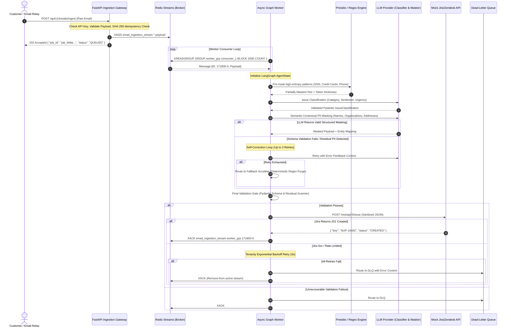
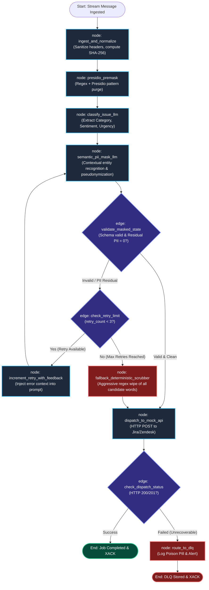

# Solution Architecture: Agentic PII Masking Workflow

**Author:** Lead AI Backend Engineer  
**Status:** Approved for Implementation  
**Target Platform:** Python 3.11+, LangGraph, Redis Streams / Celery, FastAPI, TypeSafe AI (Jev)  

---

## 1. Executive Summary & System Objectives

The **Agentic PII Masking Workflow** is an asynchronous, enterprise-grade distributed processing pipeline designed to ingest unstructured, sensitive customer support emails, categorize customer intent, scrub all Personally Identifiable Information (PII) with zero leakage tolerance, and dispatch validated tickets to downstream ticketing platforms (such as Jira Service Management or Zendesk Support).

### 1.1 Key Engineering Objectives

1. **Zero PII Leakage (Defense-in-Depth):** Guarantee that no SSN, phone number, personal email, physical address, credit card number, or medical/financial identifier enters downstream ticketing systems or external analytics platforms.
2. **Deterministic Output & Schema Enforcement:** Enforce strict Pydantic schemas at every state transition within the agentic workflow to eliminate LLM hallucinations, missing fields, and type mismatches.
3. **Fault-Tolerant State Machine:** Provide self-healing retry loops within LangGraph for transient LLM schema validation failures, paired with a deterministic regex/Presidio fallback scrubber and Dead-Letter Queue (DLQ) isolation.
4. **High-Throughput Asynchronous Decoupling:** Ingest payloads via FastAPI with sub-50ms response times, offloading compute-heavy graph processing to a distributed queue worker pool backed by Redis Streams.
5. **Continuous Verification:** Integrate TypeSafe AI's **Jev** decision model as an automated validation oracle in CI/CD and pre-dispatch checks to score sanitization confidence.

---

## 2. High-Level System Architecture & Data Flow

The system follows an **Event-Driven Architecture (EDA)** combined with a **Stateful Graph Orchestration Engine**.

```
[ Customer Support Email ]
           │
           ▼
┌──────────────────────────┐
│   FastAPI Ingestion      │ ◄─── Validates schema, hashes body for idempotency
│   (REST Webhook)         │
└──────────┬───────────────┘
           │ Pushes Job
           ▼
┌──────────────────────────┐
│ Redis Streams Pipeline   │ ◄─── Queue: `email_ingestion_stream`
│ (Consumer Group)         │      Persistence, At-least-once delivery, Backpressure
└──────────┬───────────────┘
           │ Reads Pending Message (XREADGROUP)
           ▼
┌──────────────────────────┐
│ Distributed Async Worker │ ◄─── Python Asyncio Worker Pool (ARQ / Redis Streams)
│ (LangGraph Engine)       │
└──────────┬───────────────┘
           │ Executes Orchestrated Workflow
           ▼
┌──────────────────────────────────────────────────────────────┐
│                    LangGraph State Machine                   │
│                                                              │
│  [ Ingest & Hash ] ──► [ Presidio Pre-Mask ] ──► [ LLM Classify ]
│                                                         │    │
│  [ Fallback Scrubber ] ◄── (Max Retries) ◄── [ LLM Masker ] │
│           │                                             │    │
│           ▼                                             ▼    │
│   [ Validate Schema & Residual PII ] ◄───────────────────    │
│           │                                                  │
│           ▼                                                  │
│  [ Dispatch to Mock API ] ───────────────────────────────────┘
└──────────┬───────────────────────────────────────────────────┘
           │ HTTP POST (Clean JSON Payload)
           ▼
┌──────────────────────────┐      Dead-Letter Route
│ Mock Jira/Zendesk API    │ ────────────────────────► ┌────────────────────┐
│ (With Tenacity Retries)  │ (Permanent HTTP Failures) │ Redis DLQ / Sentry │
└──────────────────────────┘                           └────────────────────┘
```

### 2.1 Component Overview

| Component | Technology | Responsibility |
| :--- | :--- | :--- |
| **Ingestion Gateway** | FastAPI, Uvicorn | Authenticates incoming webhooks, validates initial payload, computes SHA-256 idempotency key, publishes to Redis Stream. |
| **Message Broker** | Redis Streams (Redis 7.2+) | Handles durable message delivery, consumer groups, visibility timeouts, and worker acknowledgement (`XACK`). |
| **Distributed Workers** | Python 3.11, `asyncio`, ARQ / Custom Consumer | Consumes stream messages, maintains local concurrency limits, executes compiled LangGraph instances. |
| **Workflow Engine** | LangGraph 0.2+, LangChain Core | Manages multi-step state transitions, error routing, self-correction feedback loops, and fallback node execution. |
| **LLM Inference** | OpenAI / Anthropic via LangChain | Issue classification (urgency, category, sentiment) and semantic contextual PII identification. |
| **Deterministic Masker** | Microsoft Presidio, Regex Rules | High-precision pre-masking for structured tokens (SSN, credit cards, standard UUIDs/phone numbers). |
| **Downstream Egress** | `httpx` (Async), Tenacity | Dispatches sanitized, structured JSON payload to mock Jira/Zendesk endpoints with circuit breakers. |
| **Evaluation Oracle** | TypeSafe AI (Jev API) | Non-autoregressive binary decision classifier assessing masking completeness (`has_pii` vs `clean`). |

---

## 3. End-to-End Sequence Diagram

The following sequence diagram details the end-to-end lifecycle of an email from ingestion to egress:



---

## 4. LangGraph State Machine Architecture

### 4.1 State Schema Definition

The graph state is defined using Python's `TypedDict` with total type safety. Every node reads from and mutates specific keys of this state.

```python
from typing import TypedDict, List, Dict, Optional, Any
from enum import Enum
from pydantic import BaseModel, Field

class TicketPriority(str, Enum):
    LOW = "LOW"
    MEDIUM = "MEDIUM"
    HIGH = "HIGH"
    CRITICAL = "CRITICAL"

class TicketCategory(str, Enum):
    BILLING = "BILLING"
    TECHNICAL_SUPPORT = "TECHNICAL_SUPPORT"
    ACCOUNT_ACCESS = "ACCOUNT_ACCESS"
    SECURITY_INCIDENT = "SECURITY_INCIDENT"
    GENERAL_INQUIRY = "GENERAL_INQUIRY"

class IssueClassification(BaseModel):
    category: TicketCategory = Field(description="Primary category of the issue")
    urgency: TicketPriority = Field(description="Derived ticket urgency")
    sentiment: str = Field(description="Customer sentiment: POSITIVE, NEUTRAL, NEGATIVE, FRUSTRATED")
    summary: str = Field(max_length=120, description="Concise, sanitized 1-sentence issue summary")
    detected_entities: List[str] = Field(default_factory=list, description="Non-PII functional entities e.g., product names")

class PIIEntity(BaseModel):
    original_value: str = Field(description="Original sensitive value")
    entity_type: str = Field(description="Type: SSN, EMAIL, PHONE, PERSON, ADDRESS, CREDIT_CARD")
    replacement_token: str = Field(description="Synthetic replacement token, e.g. [PERSON_1]")
    start_char: int
    end_char: int

class AgentState(TypedDict):
    # Ingestion Data
    job_id: str
    raw_email_id: str
    sender_email: str
    subject: str
    body: str
    received_at: str
    
    # Intermediate Processing States
    content_hash: str
    presidio_masked_body: str
    surrogate_mapping: Dict[str, str] # e.g. {"[SSN_1]": "000-12-3456"}
    
    # LLM Structured Outputs
    classification: Optional[IssueClassification]
    llm_masked_body: Optional[str]
    detected_pii_entities: List[Dict[str, Any]]
    
    # Sanitized Final Artifact
    sanitized_subject: str
    sanitized_body: str
    
    # Control & Resilience Metadata
    retry_count: int
    validation_errors: List[str]
    is_fallback_triggered: bool
    status: str # "INITIALIZED", "PRE_MASKED", "CLASSIFIED", "MASKED", "VALIDATED", "DISPATCHED", "FAILED"
    error_message: Optional[str]
    dispatched_ticket_id: Optional[str]
```

### 4.2 Graph Topology & State Transitions

The state graph combines deterministic algorithmic filters, LLM inference, validator gates, and self-healing loopbacks.



### 4.3 Node Responsibilities

1. **`ingest_and_normalize`:** Strips non-standard ASCII control characters, normalizes line endings, generates canonical hash for idempotency, and populates `AgentState`.
2. **`presidio_premask`:** Evaluates high-entropy structured tokens using deterministic regex patterns (US SSN, Credit Cards, E.164 Phone Numbers). Replaces matches with surrogate IDs (e.g., `[SSN_1]`, `[CARD_1]`) and registers them in `surrogate_mapping`. This eliminates heavy cognitive load on the downstream LLM.
3. **`classify_issue_llm`:** Calls LLM with strict Pydantic output parsing to obtain `IssueClassification`. Does not mutate email text, preventing classification artifacts from altering PII positions.
4. **`semantic_pii_mask_llm`:** Evaluates contextual and unstructured PII (person names, physical street addresses, company names, informal handles). Generates surrogate replacement tokens (`[PERSON_1]`, `[ADDRESS_1]`) and updates the body.
5. **`validate_masked_state` (Conditional Edge):** Runs a composite verification:
   - Validates that `IssueClassification` satisfies all bounds.
   - Executes a secondary, high-sensitivity Presidio/Regex scanner over `sanitized_body` to confirm zero remaining high-risk PII tokens.
   - Confirms that original sensitive values from `surrogate_mapping` do not appear anywhere in `sanitized_body` or `sanitized_subject`.
6. **`fallback_scrubber`:** Executes in the event of repeated LLM hallucinations or schema failures. Applies aggressive deterministic dictionary replacement and redaction (`[REDACTED]`), guaranteeing 100% compliance before egress even if the LLM provider fails completely.
7. **`dispatch_to_mock_api`:** Builds final clean JSON payload and makes an authenticated async HTTP call to Mock Jira/Zendesk API using `httpx` with exponential backoff.
8. **`route_to_dlq`:** Serializes failed state with full audit trail into Redis DLQ key `email_dlq_stream`.

---

## 5. Background Worker & Queue Architecture

### 5.1 Ingestion & Queue Topology

```
                  ┌──────────────────────────────┐
                  │   FastAPI Ingestion Pods     │
                  └──────────────┬───────────────┘
                                 │ XADD
                                 ▼
         ┌────────────────────────────────────────────────┐
         │     Redis 7.2 Cluster (AOF + RDB Enabled)      │
         │                                                │
         │ Stream: `email_ingestion_stream`               │
         │ Consumer Group: `agentic_masking_workers`      │
         └───────┬───────────────────────────────┬────────┘
                 │                               │
       ReadGroup │                     ReadGroup │
                 ▼                               ▼
    ┌─────────────────────────┐     ┌─────────────────────────┐
    │ Graph Worker Node #1    │     │ Graph Worker Node #2    │
    │ (Asyncio Task Pool: 16) │     │ (Asyncio Task Pool: 16) │
    └─────────────────────────┘     └─────────────────────────┘
```

### 5.2 Stream Guarantees & Fault Tolerance

1. **At-Least-Once Delivery:** Messages are consumed using `XREADGROUP`. Messages remain in the Pending Entries List (PEL) until an explicit `XACK` is received upon successful ticket creation or DLQ persistence.
2. **Crash Recovery (`XAUTOCLAIM`):** A background sweeper task runs every 30 seconds on each worker node. If a worker dies while executing a LangGraph graph, any message pending for greater than `MIN_IDLE_TIME` (90,000ms) is automatically claimed by healthy workers.
3. **Idempotency Barrier:** Before initiating graph execution, the worker sets a Redis key:
   ```
   SET pii:idempotency:<content_hash> <job_id> NX EX 86400
   ```
   If the key exists, the message is acknowledged (`XACK`) and skipped immediately to prevent duplicate ticket generation.
4. **Dead-Letter Queue (DLQ) & Poison Pill Isolation:** If a message fails execution 3 times (tracked via `XPENDING` delivery count), it is extracted from the main stream, appended to `email_dlq_stream` with full error stack traces, and acknowledged from the primary stream.

---

## 6. Clean JSON Egress Contract (Mock Jira / Zendesk)

The output payload sent to the mock API is strictly validated against the following OpenAPI/Pydantic schema:

```json
{
  "$schema": "http://json-schema.org/draft-07/schema#",
  "title": "SanitizedSupportTicketPayload",
  "type": "object",
  "properties": {
    "external_job_id": { "type": "string", "format": "uuid" },
    "source_system": { "type": "string", "enum": ["CUSTOMER_SUPPORT_EMAIL"] },
    "ticket_metadata": {
      "type": "object",
      "properties": {
        "category": { "type": "string", "enum": ["BILLING", "TECHNICAL_SUPPORT", "ACCOUNT_ACCESS", "SECURITY_INCIDENT", "GENERAL_INQUIRY"] },
        "priority": { "type": "string", "enum": ["LOW", "MEDIUM", "HIGH", "CRITICAL"] },
        "sentiment": { "type": "string", "enum": ["POSITIVE", "NEUTRAL", "NEGATIVE", "FRUSTRATED"] },
        "summary": { "type": "string", "maxLength": 120 }
      },
      "required": ["category", "priority", "sentiment", "summary"]
    },
    "sanitized_content": {
      "type": "object",
      "properties": {
        "subject": { "type": "string" },
        "scrubbed_body": { "type": "string" },
        "anonymized_entities": {
          "type": "array",
          "items": {
            "type": "object",
            "properties": {
              "token": { "type": "string" },
              "entity_type": { "type": "string" }
            },
            "required": ["token", "entity_type"]
          }
        }
      },
      "required": ["subject", "scrubbed_body", "anonymized_entities"]
    },
    "audit_trail": {
      "type": "object",
      "properties": {
        "pii_detected_count": { "type": "integer" },
        "fallback_triggered": { "type": "boolean" },
        "processing_duration_ms": { "type": "number" },
        "graph_version": { "type": "string" }
      },
      "required": ["pii_detected_count", "fallback_triggered", "processing_duration_ms", "graph_version"]
    }
  },
  "required": ["external_job_id", "source_system", "ticket_metadata", "sanitized_content", "audit_trail"]
}
```

> [!IMPORTANT]
> The `anonymized_entities` array contains only the synthetic token (e.g. `[PERSON_1]`) and the entity category (`PERSON`). Under no circumstances is the original plaintext value included in the downstream payload. Plaintext mappings are temporarily held in an in-memory TTL cache within the internal secure enclave if reversibility is required for human agents.

---

## 7. Security, Privacy & Data Compliance Architecture

1. **Principle of Ephemeral Memory:** LangGraph state objects are contained strictly within worker memory. State history checkpoints (checkpointers) use an in-memory or encrypted SQLite/Postgres checkpointer with row-level encryption (AES-256-GCM).
2. **Zero Plaintext Logging:** Logging formatters (`structlog`) use custom redaction processors to sanitize stdout/stderr. Any log line containing patterns matching email, phone numbers, or credit cards is masked prior to being emitted to vector logs (Datadog / CloudWatch).
3. **Surrogate Key Consistency:** If a customer mentions their email multiple times in one thread (e.g., `"contact me at alex@example.com or support@example.com, prefer alex@example.com"`), the system assigns identical surrogate IDs to identical plaintext values:
   - `alex@example.com` -> `[EMAIL_1]`
   - `support@example.com` -> `[EMAIL_2]`
   - `alex@example.com` -> `[EMAIL_1]` (Consistency preserved for context).

---

## 8. Summary of Architectural Decisions (ADR)

| Decision ID | Context | Decision | Consequence |
| :--- | :--- | :--- | :--- |
| **ADR-001** | Orchestration framework selection | Choose **LangGraph** over simple scripts or CrewAI. | Enables native cycle loops, conditional routing, explicit TypedDict state validation, and fine-grained error recovery. |
| **ADR-002** | Multi-tier PII Masking | Hybrid approach: Microsoft Presidio (regex/heuristics) + LLM semantic masking. | Maximizes recall and precision: deterministic speed for regular tokens + LLM contextual understanding for complex entities. |
| **ADR-003** | Queue mechanism | Redis Streams instead of Celery/RabbitMQ or Kafka. | Low operational overhead for single-cluster setups, native consumer group support, atomic PEL management, sub-millisecond latency. |
| **ADR-004** | Automated Eval Pipeline | TypeSafe AI (**Jev**) decision model. | Replaces slow, non-deterministic LLM-as-a-judge with a sub-500ms, calibrated binary decision oracle for PII leakage verification in CI/CD. |
